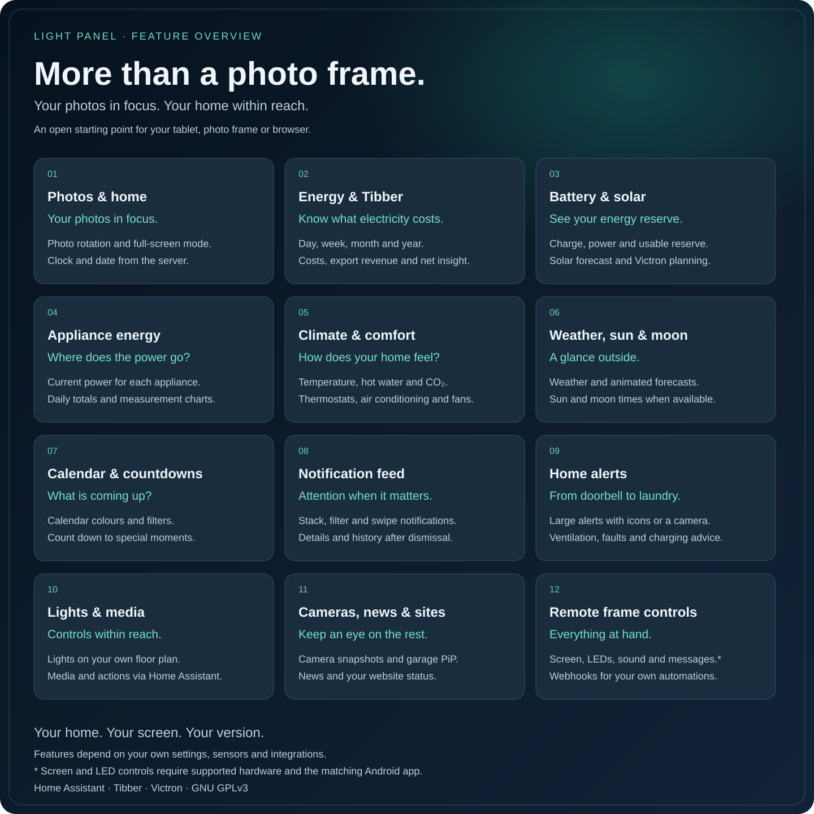
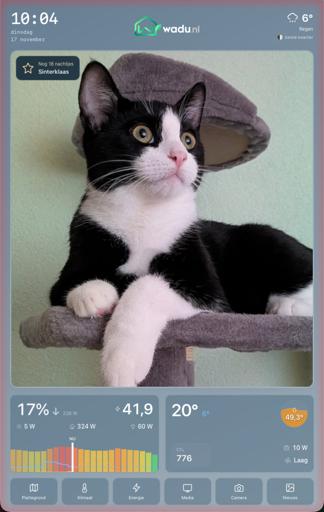
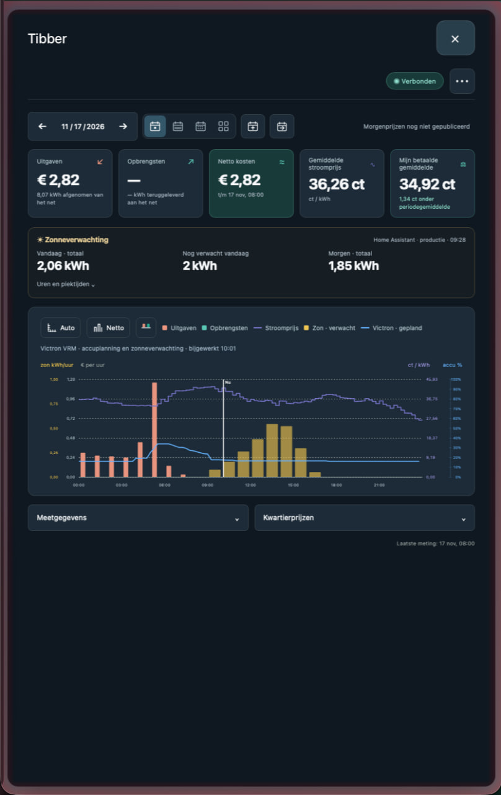
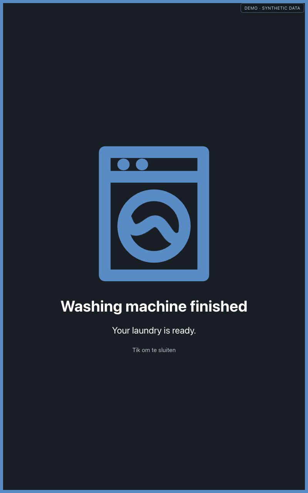
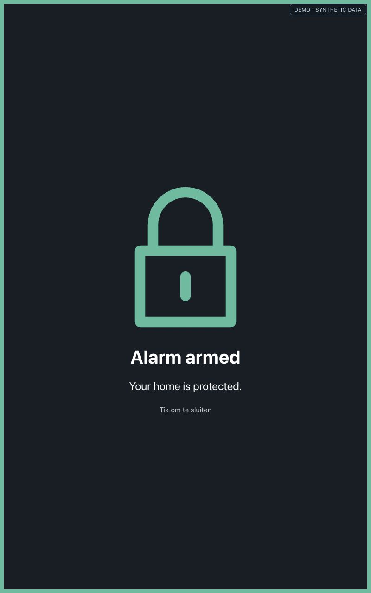
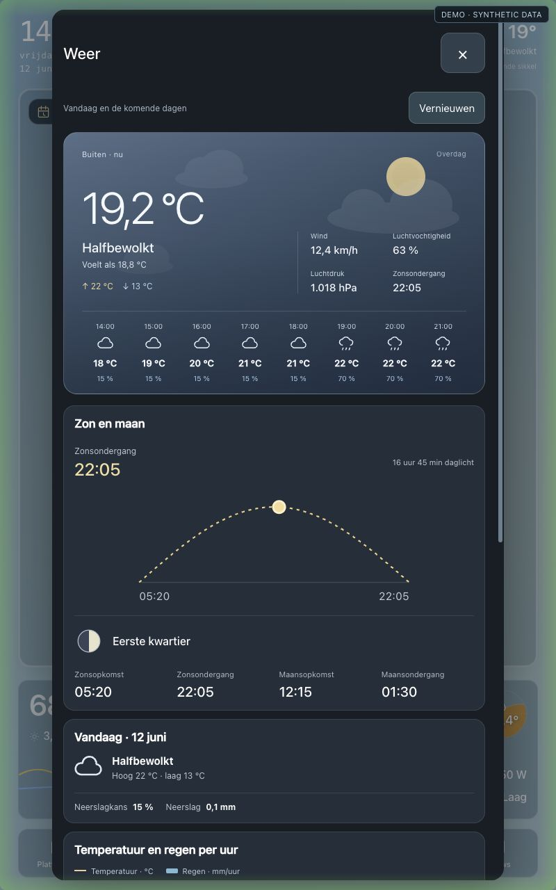
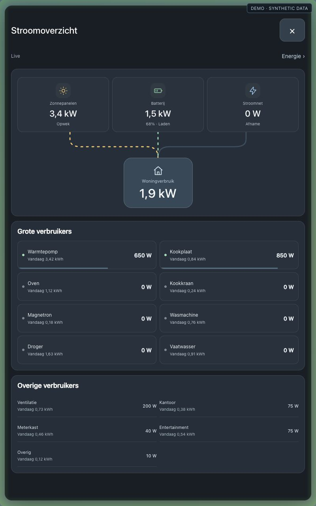

# Light Panel

**English** · [Nederlands](README.nl.md)

**Your photos in focus. Your home within reach.** A personal dashboard for a photo frame, tablet or browser, with optional Home Assistant, Tibber and Victron integrations.



## Inspiration: the original installation

These reference screenshots show the creator’s original installation, including its branding, photo and readings at the time. They illustrate what a configured panel can look like; the runnable starter opens with empty integrations.

| Home screen | Tibber energy detail |
| --- | --- |
| <a href="docs/frame-full.jpg"></a> | <a href="docs/frame-tibber.jpg"></a> |

Click an image to open it at full size.

## More example screenshots

Full-screen appliance and alarm messages, weather, heat-pump temperature charts and appliance energy. These additional examples use synthetic data and show the existing interface. Some interface labels are Dutch.

| Washing machine finished | Alarm armed |
| --- | --- |
| <a href="docs/screenshots/washer-finished.jpg"></a> | <a href="docs/screenshots/alarm-armed.jpg"></a> |

| Weather | Appliance energy |
| --- | --- |
| <a href="docs/screenshots/weather.jpg"></a> | <a href="docs/screenshots/appliance-energy.jpg"></a> |

[Browse all ten screenshots, including disarmed alarm and temperature history](docs/screenshots/README.md).

## What can it do?

| | Area | Features with your own integrations |
| --- | --- | --- |
| 🖼️ | Photos & home | Automatic photo rotation, full-screen photos and a clock based on server time. |
| ⚡ | Energy & Tibber | Current prices, coloured hourly bars, costs, export revenue and net costs by day, week, month and year. Compare the average price with your paid average; tomorrow’s prices when available. |
| 🔋 | Battery & solar | State of charge, charging/discharging power, usable energy above the reserve, minimum charge line, solar forecasts and Victron planning. Charging advice considers battery room and expected solar. |
| 🔌 | Appliance energy | Current power, available daily totals and measurement charts for your configured devices. |
| 🌡️ | Climate | Indoor/outdoor temperature, hot water, CO₂, heat pump power and ventilation. Heating/cooling glow; supported thermostat, air conditioning and fan controls. |
| 🌦️ | Weather, sun & moon | Animated weather, hourly and daily forecasts, moon phase and available sun/moon times. |
| 📅 | Calendar & countdowns | Day/week/month views, calendar colours and filters, appointment details and countdowns. |
| 🗂️ | Notification feed | Fire/ambulance/GRIP alerts, a compact aircraft strip, stacked cards, swipe/dismiss, filters, details and history. Requires suitable sources. |
| 🔔 | Home notifications | Large animated messages, icons and camera snapshots for doorbell, garage, appliances, ventilation, faults, aurora and charging advice, depending on configured sources. |
| 💡 | Lights & media | Lights on your own floor plan, supported brightness/colour controls, media and your own HA service/script actions. |
| 📷 | Cameras, news & websites | Refreshed camera snapshots, garage picture-in-picture, news and availability checks for your websites. Snapshots are not a video stream. |
| 🖥️ | Remote frame controls | Screen, LEDs, screenshots, sound, full-screen messages and webhooks for connected hardware frames. Hardware controls require a compatible device and Android app. |

Features depend on your own sensors, settings and services. The runnable starter has an empty photo library, generic branding and no personal floor plan, credentials or original private repository history. The reference screenshots above are documentation assets. Integrations start empty; missing values are not populated with invented live data. Some interface text and technical routes still use Dutch or the name Frameo.

## Quick start

Install Docker with Docker Compose. Download or clone this repository, open its folder in a terminal, then run:

```sh
cp .env.example .env
docker compose up -d --build
```

Open **http://localhost:8089**. Stop with `docker compose down`; your local settings and history remain on disk.

## Connect your Home Assistant

1. Create a long-lived access token in your HA user profile.
2. Set your own `HA_URL` and `HA_TOKEN` in `.env`. Use an address reachable from the container; an HTTPS Nabu Casa address can also work.
3. Copy the example:

   ```sh
   cp config.example.json config/settings.json
   ```

4. Replace the fictional `example_*` entities with your own IDs from HA’s developer tools. Remove optional sections you do not use. This is a complete configuration file, not a partial patch.
5. Restart after changing `.env` or settings:

   ```sh
   docker compose up -d --force-recreate
   ```

See the [configuration guide](docs/configuratie.md). Adapt example device actions before using them.

## Add your photos

Put your own pictures in `photos/` and refresh the page. Photos, `.env`, local `config/settings.json`, runtime notification history and Android build/signing files are ignored by Git. Personal runtime data is also excluded from the Docker build context.

## Build your own version with AI

The [AI starter guide](docs/AI-START.md) includes a copyable prompt, a map of the source code and suggestions for adapting the panel to your screen and devices without sharing secrets.

On GitHub, choose **Use this template → Create a new repository** to start your own project.

## Home Assistant webhooks and automations

The [HA package](home-assistant/README.md) includes scripts, a control dashboard and disabled example automations for doorbell, garage, appliances, alarm and screen schedules. Supply your own server address, webhook key and entity IDs. No personal HA configuration is included.

## Tablet, frame and automatic startup

By default, Docker listens only on this computer. For devices on your trusted LAN, set `BIND_ADDRESS=0.0.0.0` in `.env`, restart, then use `http://YOUR_SERVER:8089`.

Try a browser first. For native screen/LED controls, build the optional [Android app](docs/android.md). On a supported frame, **select Light Panel as the default Home app and choose Always**. The launcher and boot fallback then return to the dashboard after Android restarts; it retries while Wi-Fi or the server is unavailable. The device firmware must itself boot when power returns.

The [Frameo/Denver guide](docs/frameo-adb-root.md) covers recovered ADB steps, checking existing root and the supported hardware interfaces. It does not claim to root an unmodified frame.

The administration pages do not have general login protection. Keep the service on a trusted network and do not expose port 8089 directly to the internet. The webhook has its own key, which does not protect other management routes. Keep secrets in your own `.env` and HA `secrets.yaml`.

## Development and checks

After source changes: `docker compose up -d --build`. Open dashboard pages can reload after the backend restarts.

Basic and webhook contract checks:

```sh
docker compose run --rm light-panel python -m unittest discover -s tests -v
```

HA YAML/template checks additionally need `tests/requirements.txt` (PyYAML and Jinja2). Without these development dependencies, that test class is skipped. Run the focused tests in an environment with those installed:

```sh
python -m unittest discover -s tests -p test_home_assistant.py -v
```

These checks do not replace Home Assistant’s own configuration validation or a real power-cycle test on your frame.

## License

The current version uses [GNU GPLv3](LICENSE), GPL-3.0-only. Keep the corresponding source code and license obligations in mind when distributing changes. The first public version was MIT-licensed; see [NOTICE](NOTICE.md). Third-party files keep their own terms.
