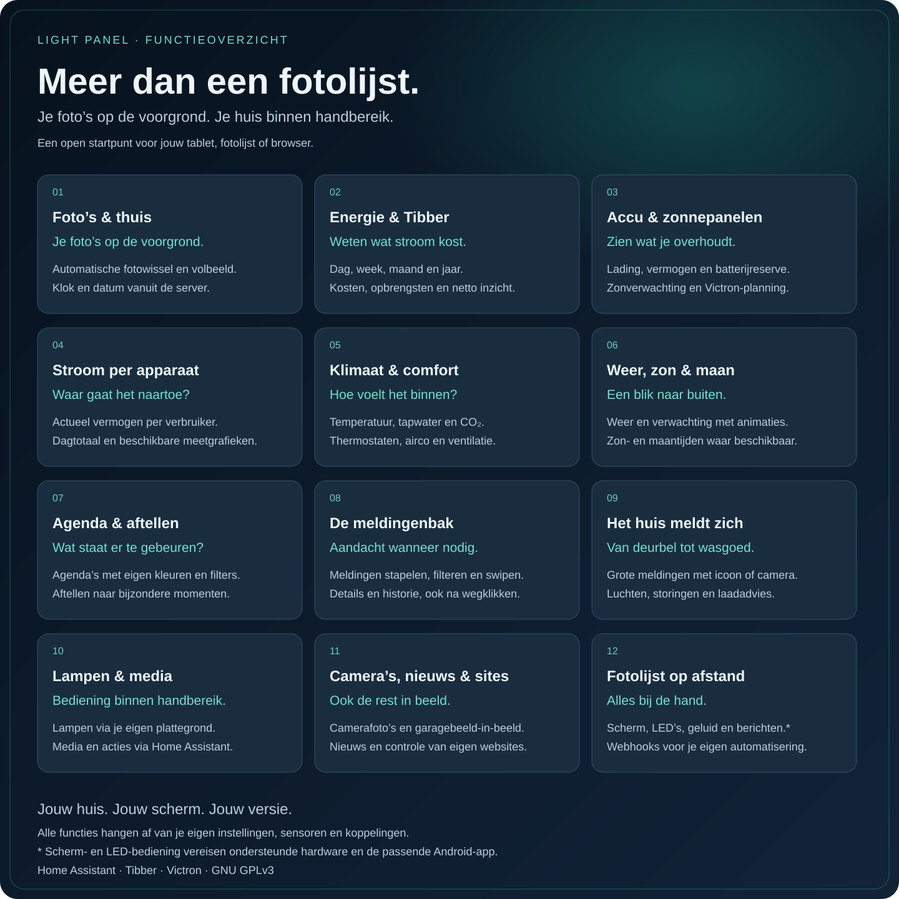

[English](README.md) · **Nederlands**

# Light Panel

**Je foto’s op de voorgrond. Je huis binnen handbereik.** Een persoonlijk dashboard voor een fotolijst, tablet of browser.



## Alles wat Light Panel kan

| | Onderdeel | Mogelijkheden met je eigen koppelingen |
| --- | --- | --- |
| 🖼️ | **Foto’s & thuis** | Automatische fotowissel, foto op volledig scherm, klok en datum met servertijd. |
| ⚡ | **Energie & Tibber** | Actuele prijs, gekleurde uurbalken, kosten en teruglevering per dag, week, maand en jaar. Jouw betaalde gemiddelde naast de gemiddelde stroomprijs; morgenprijzen zodra beschikbaar. |
| 🔋 | **Accu & zonnepanelen** | Lading, laad- of ontlaadvermogen, beschikbare kWh boven de reserve, laadgrafiek en ondergrens. Victron-planning en zonverwachting naast de stroomprijs; laadadvies met batterijruimte en verwachte zon. |
| 🔌 | **Stroom per apparaat** | Huidig vermogen en beschikbaar dagtotaal per verbruiker. Van warmtepomp en witgoed tot kantoor en entertainment, met meetgrafieken. |
| 🌡️ | **Klimaat & comfort** | Binnen- en buitentemperatuur, tapwater, CO₂, warmtepompvermogen en ventilatie. Gloed bij verwarmen of koelen; bediening van ondersteunde thermostaten, airco’s en ventilatiestanden. |
| 🌦️ | **Weer, zon & maan** | Actueel weer, uur- en meerdaagse verwachting, bewegende weerweergave, maanstand en beschikbare zon- en maantijden. |
| 📅 | **Agenda & aftellen** | Dag-, week- en maandagenda, kleuren en filters per agenda, afspraakdetails en aftellen naar bijzondere momenten. |
| 🗂️ | **De meldingenbak** | Brandweer, ambulance, GRIP en een compacte vliegtuigenbalk. Nieuwste kaart bovenop, één voor één swipen of openen, filters en bewaarde historie. |
| 🔔 | **Het huis meldt zich** | Grote meldingen met animaties, icoon of camerafoto. Deurbel, garage, apparaten klaar, wasgoedherinnering, CO₂, storingen, noorderlichtkans en goedkoop laden, afhankelijk van ingestelde bronnen. |
| 💡 | **Lampen & entertainment** | Lampen via je eigen plattegrond, helderheid en kleur waar ondersteund. Media, volume en andere acties via jouw HA-services en scripts. |
| 📷 | **Camera’s, nieuws & sites** | Camerafoto’s die tijdens een melding verversen, garagebeeld-in-beeld, nieuws van NOS en Tweakers en beschikbaarheidscontrole van eigen websites. Camerafoto’s zijn geen videostream. |
| 🖥️ | **Fotolijst op afstand** | Beheerpagina, schermbeelden, grote berichten, geluid, webhooks en bediening van verbonden fotolijsten. Scherm en LED’s vereisen ondersteunde hardware en de passende Android-app. |

**Laat het met je dag meelopen.** Je kunt via eigen Home Assistant-automatiseringen het scherm en de LED’s laten reageren op lampen, entertainment of aanwezigheid. Persoonlijke automations en apparaatinstellingen worden niet meegeleverd.

[Open de functieposter afzonderlijk](docs/functieposter.nl.svg) · [Maak je eigen versie met AI](docs/AI-START.nl.md)


Deze startversie bevat geen persoonlijke foto’s, huisplattegrond, logo, accountgegevens of geschiedenis van het oorspronkelijke project. Koppelingen zijn optioneel en starten leeg. Zonder Home Assistant zie je nog geen eigen meetwaarden; dit is een startscherm, geen gevulde demo.

## Beginnen in vijf minuten

Installeer Docker met Docker Compose. Download deze repository als zip of kloon hem, open een terminal in de projectmap en voer uit:

```sh
cp .env.example .env
docker compose up -d --build
```

Open **http://localhost:8089**. Poort 8080 op de computer blijft beschikbaar voor andere toepassingen. Stoppen kan met `docker compose down`; lokale instellingen en meldingen blijven bewaard.

## Je eigen Home Assistant verbinden

1. Maak in Home Assistant via je gebruikersprofiel een langlevend toegangstoken.
2. Vul in `.env` je eigen `HA_URL` en `HA_TOKEN` in. Zowel een lokaal adres als je eigen HTTPS-adres via Nabu Casa kan werken, mits bereikbaar vanaf de Docker-container.
3. Kopieer de voorbeeldinstellingen:

   ```sh
   cp config.example.json config/settings.json
   ```

4. Vervang de `example_*` entiteiten door je eigen entiteiten uit **Ontwikkelaarstools → Statussen**. Verwijder onderdelen die je niet hebt. Het hele configuratiebestand wordt ingelezen; dit is geen gedeeltelijke aanvulling op het voorbeeld.
5. Herstart na een wijziging aan instellingen of `.env`:

   ```sh
   docker compose up -d --force-recreate
   ```

Zie [de configuratiegids](docs/configuratie.nl.md) voor sensoren, camera’s, energie en acties. Pas voorbeeldacties aan jouw apparaten aan voordat je ze gebruikt.

## Je eigen versie maken met AI

Gebruik de [AI-startgids](docs/AI-START.nl.md) voor een kopieerbare prompt, uitleg over de code en een aanpak om Light Panel aan je eigen huis en scherm aan te passen.

## Foto’s

Plaats je eigen foto’s in `photos/` en vernieuw de pagina. Je foto’s en lokale instellingen zijn uitgesloten van Git en van de Docker-image. Ze worden via lokale mappen aan de container gekoppeld.

## Wat kan het dashboard?

- Foto’s en een fotostand op volledig scherm.
- Energiekaart met batterijpercentage, actueel verbruik, zon en stroomprijs.
- Tibber-detail met dag, week, maand en jaar, kosten en teruglevering.
- Optioneel Victron-planning en zonverwachting.
- Klimaat, CO₂, tapwater, ventilatie en thermostaten.
- Meldingen met historie, filters en animaties; camerafoto’s en garagebeeld in beeld.
- Kalender, weer, nieuws en instelbare websitecontrole.
- Fotolijstbediening, webhooks en grote meldingen. Geluid is instelbaar.
- Optionele Android-kiosk met scherm- en LED-bediening op ondersteunde hardware.

Wat zichtbaar werkt, hangt af van je eigen koppelingen en sensoren. Hardwarefuncties zijn niet beschikbaar in een gewone browser. De naam Frameo komt nog voor in technische routes en onderdelen voor compatibiliteit.

## Home Assistant-webhooks en automations

Het [Home Assistant-pakket](home-assistant/README.nl.md) bevat scripts, een bedieningsdashboard en uitgeschakelde voorbeeldautomations voor je eigen deurbel, garage, apparaten, alarm en schermtijden. Je vult zelf het dashboardadres, de webhook-sleutel en entiteiten in.

## Op een tablet of fotolijst

De standaard is alleen toegankelijk op deze computer. Voor apparaten op je eigen netwerk zet je in `.env`:

```dotenv
BIND_ADDRESS=0.0.0.0
```

Herstart en open `http://IP-VAN-JE-SERVER:8089` op je apparaat. Gebruik eerst een gewone browser. Voor de optionele kioskbroncode zie [Android](docs/android.nl.md). De [Frameo / Denver-handleiding](docs/frameo-adb-root.nl.md) beschrijft ADB, controle van bestaande root, installatie en hardwarebediening.

Het dashboard bevat bediening voor je huis en een beheerpagina zonder algemene aanmeldbeveiliging. Gebruik deze instelling daarom alleen op een vertrouwd lokaal netwerk; zet poort 8089 niet rechtstreeks open naar internet. De webhook heeft een eigen sleutel, maar die beveiligt niet de overige beheerfuncties. Bewaar tokens uitsluitend in je eigen `.env` en deel dat bestand niet.

## Updates en bijdragen

Na wijzigingen aan broncode: `docker compose up -d --build`. Bij een herstart van de backend kunnen geopende dashboardpagina’s automatisch vernieuwen.

Light Panel is een zelfstandige template met een nieuwe Git-geschiedenis. Gebruik op GitHub **Use this template → Create a new repository** om je eigen versie te beginnen. Je eigen configuratie en foto’s blijven lokaal en worden niet meegecommit.

Light Panel valt vanaf deze versie onder de [GNU GPLv3](LICENSE) (GPL-3.0-only). Bij verspreiding van aangepaste versies moet de bijbehorende broncode onder GPLv3 beschikbaar blijven. Zie [NOTICE](NOTICE.nl.md) voor meegeleverde bronnen van derden.
