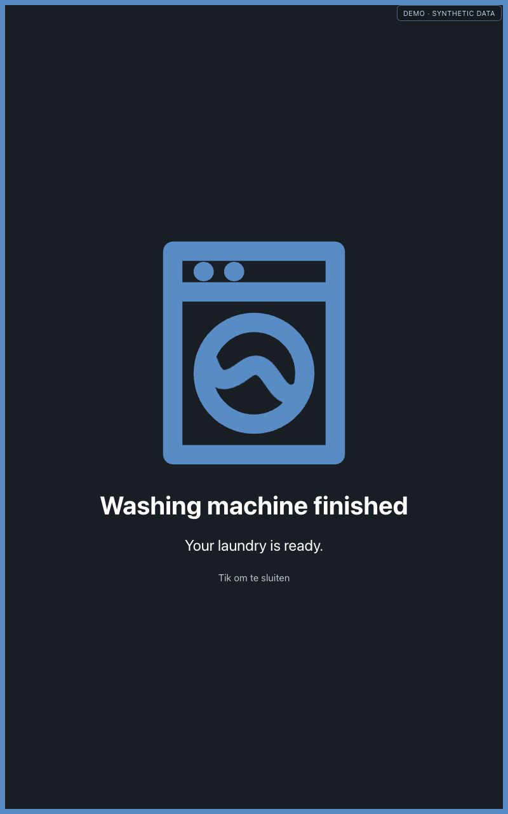
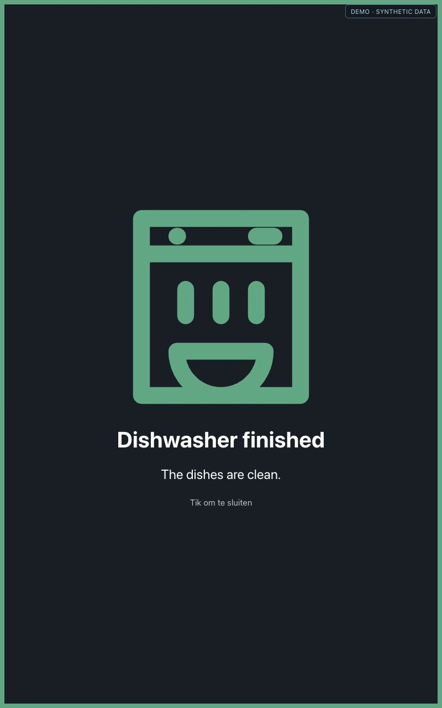
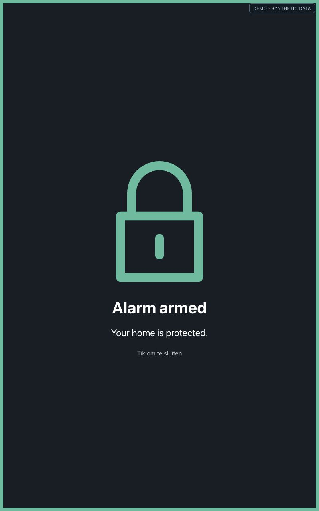
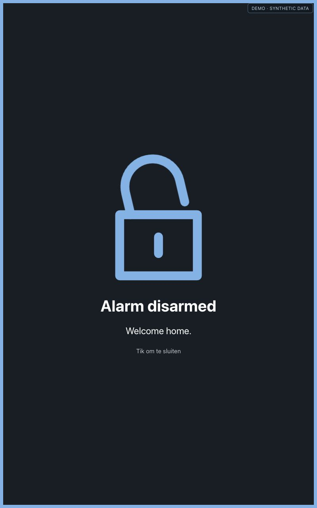
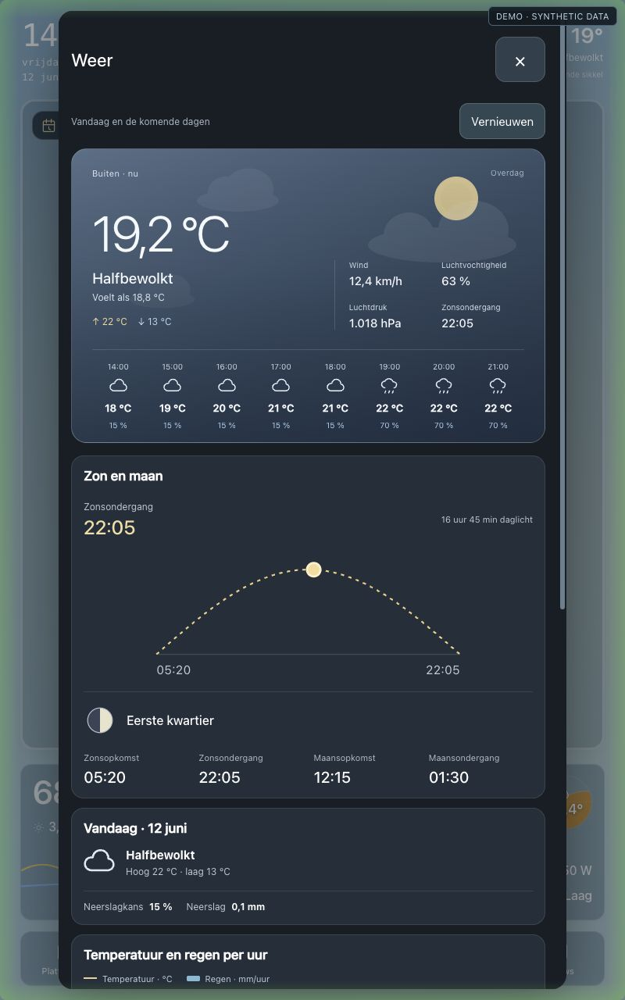
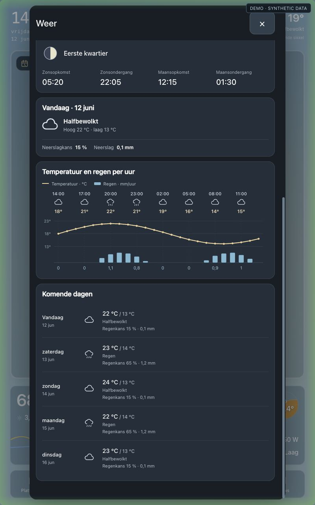
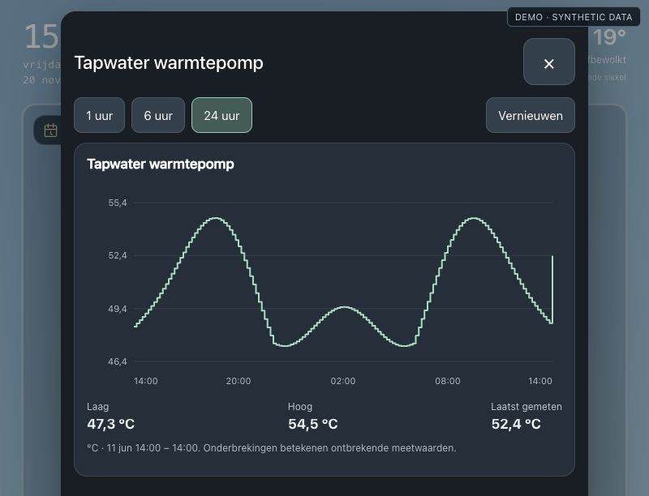
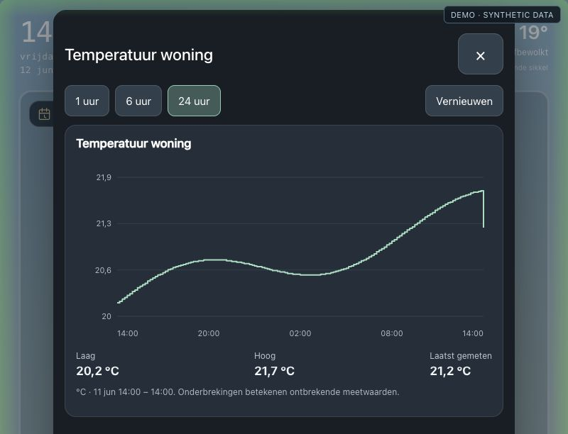
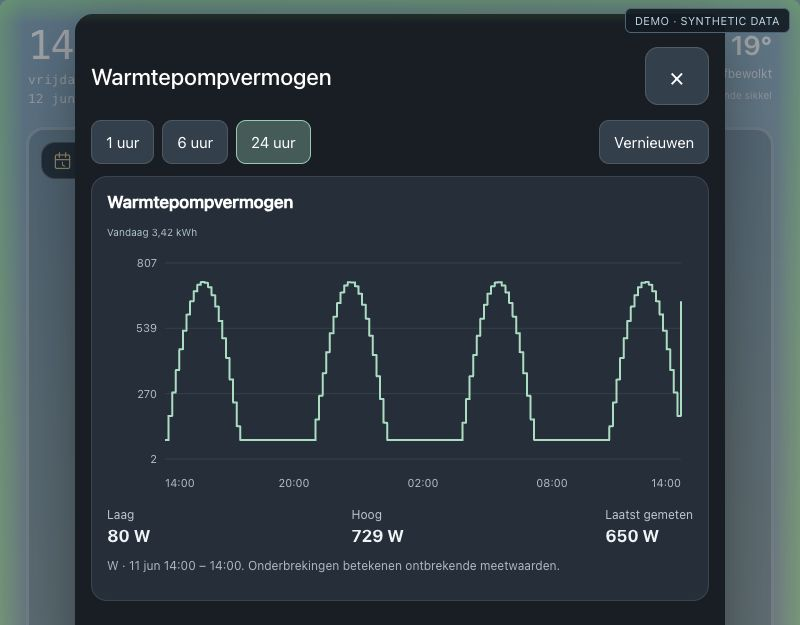
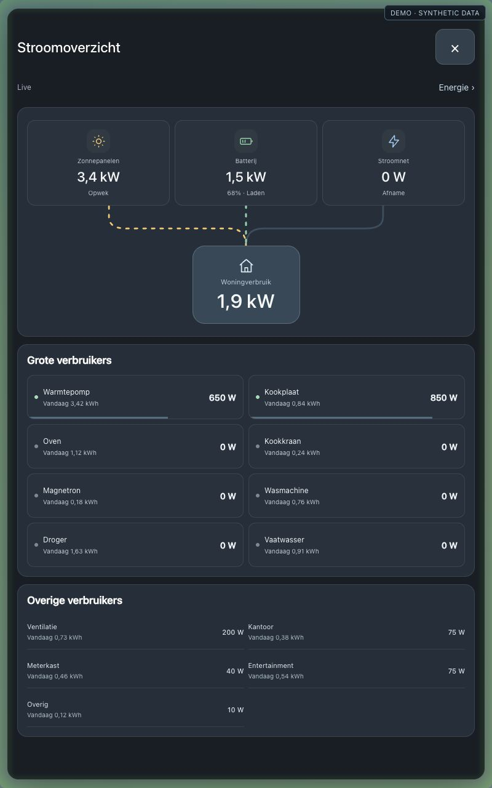

# Example screenshots

**English** · [Nederlands](README.nl.md)

Captured from the real Light Panel interface using synthetic data only. Every image carries a DEMO label. Values are not household measurements. Still images show a moment from animated notifications; the alarm images show their final state.

The three measurement charts are cropped for detail readability.

| Washing machine finished | Dishwasher finished |
| --- | --- |
|  |  |

| Alarm armed | Alarm disarmed |
| --- | --- |
|  |  |

| Weather, sun and moon | Hourly and daily forecast |
| --- | --- |
|  |  |

| Heat pump hot-water temperature | Indoor temperature history |
| --- | --- |
|  |  |

| Heat pump power history | Appliance power and daily energy |
| --- | --- |
|  |  |

## Reproduce

With the project dependencies installed, run `python tools/screenshot_demo.py` from the repository root. Open `http://127.0.0.1:8093/` and choose an example. Controls hide automatically; Escape restores them. The preview never reads `.env`, contacts HA or controls a real device. Dates and sensor values are fixed synthetic examples.

The [HTML gallery](index.html) can also be opened locally with these image files.
