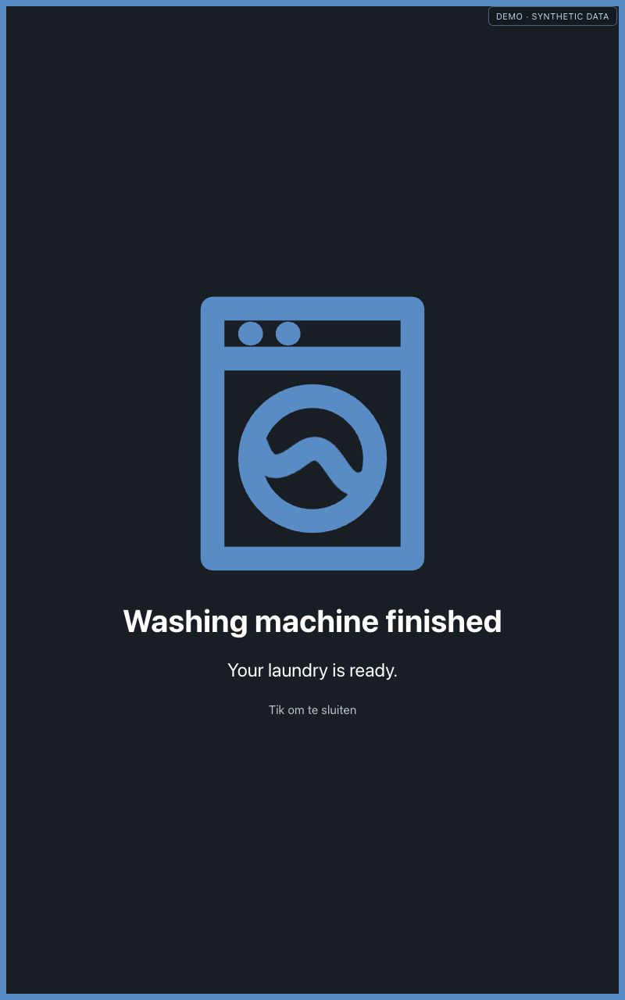
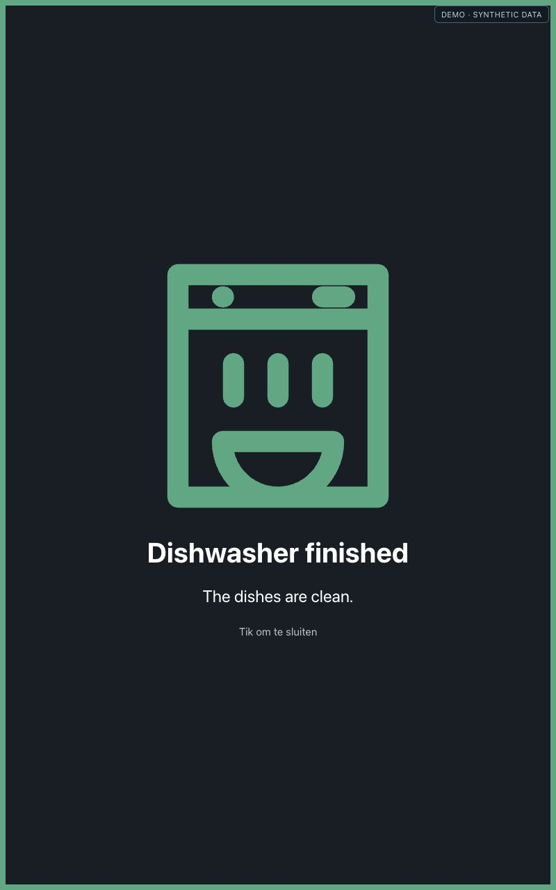
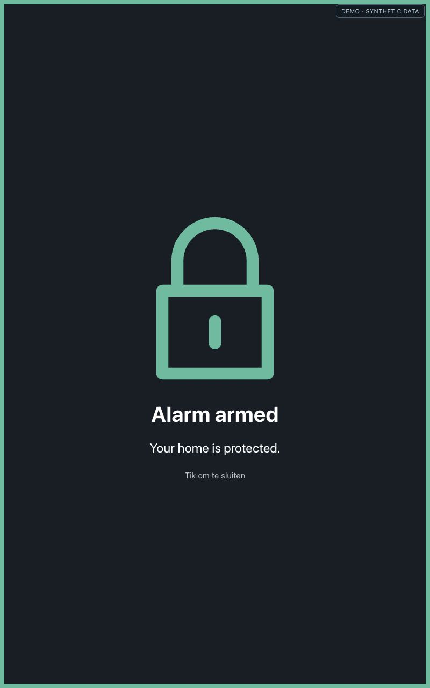
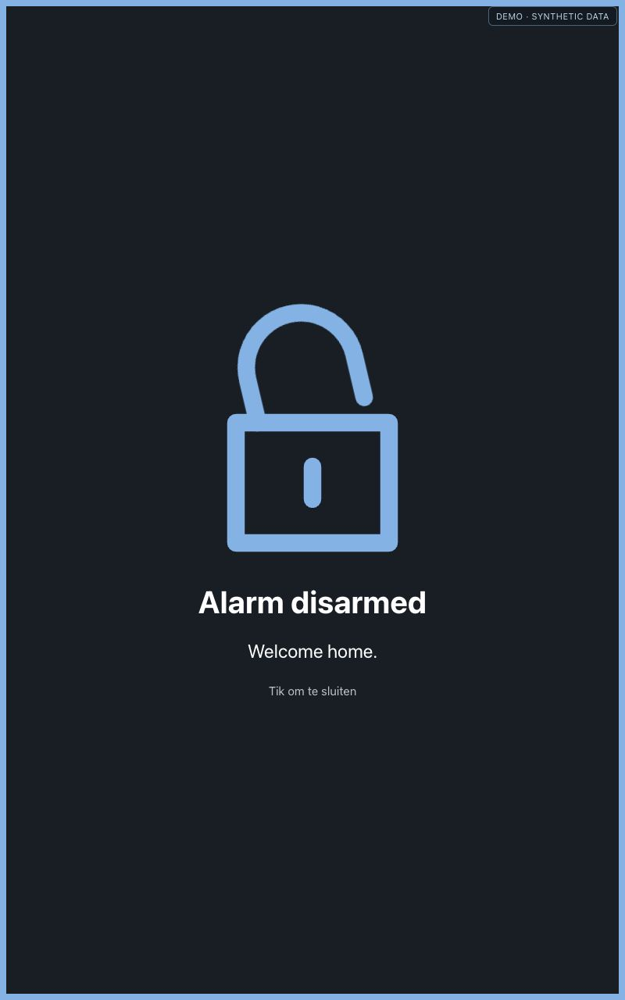
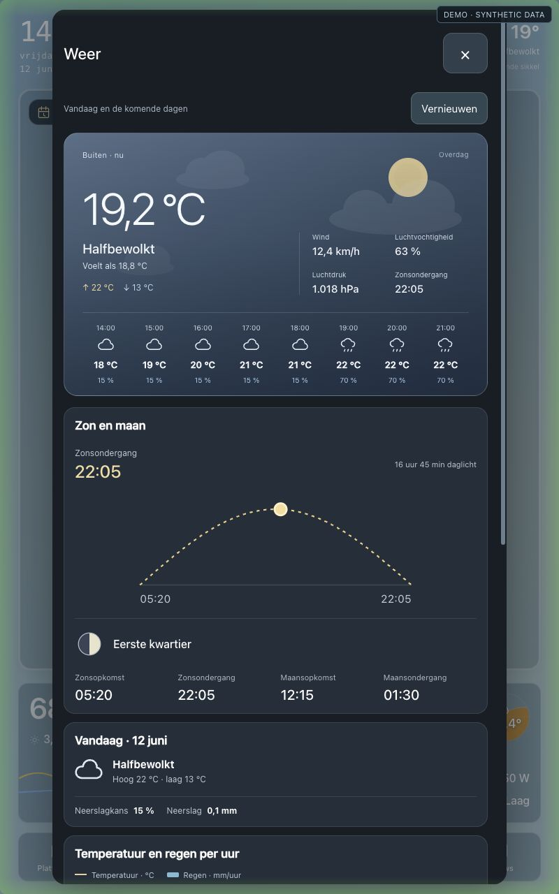
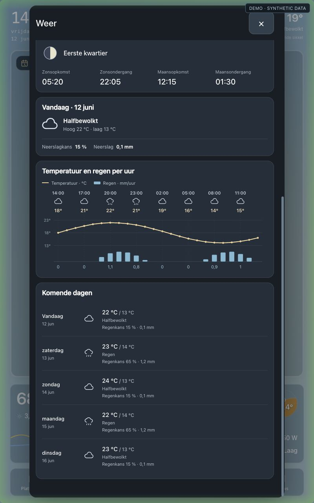
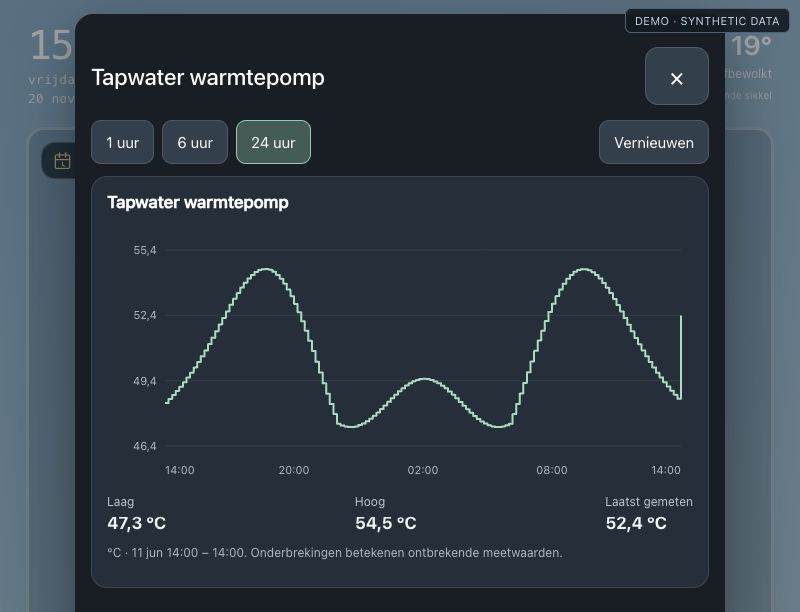
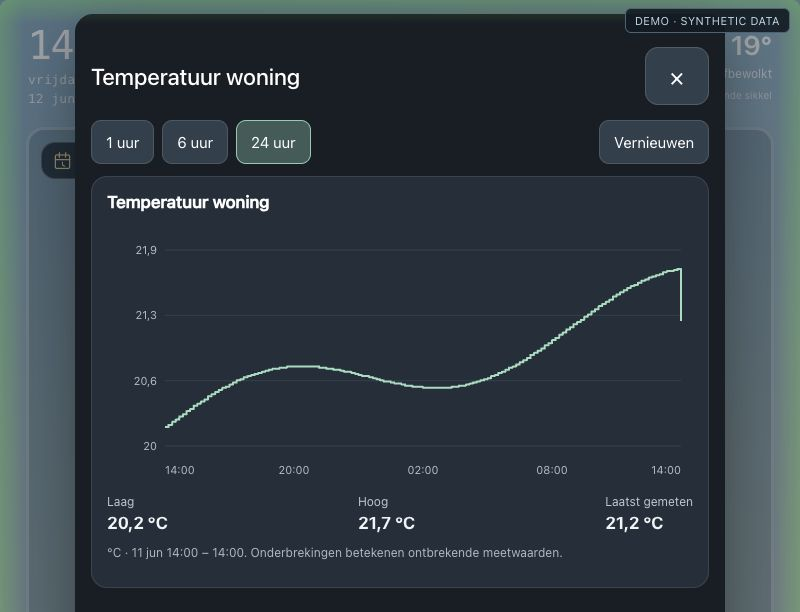
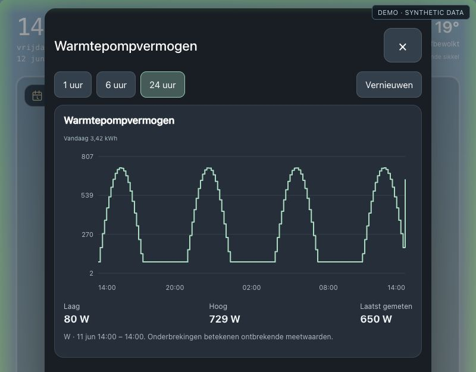
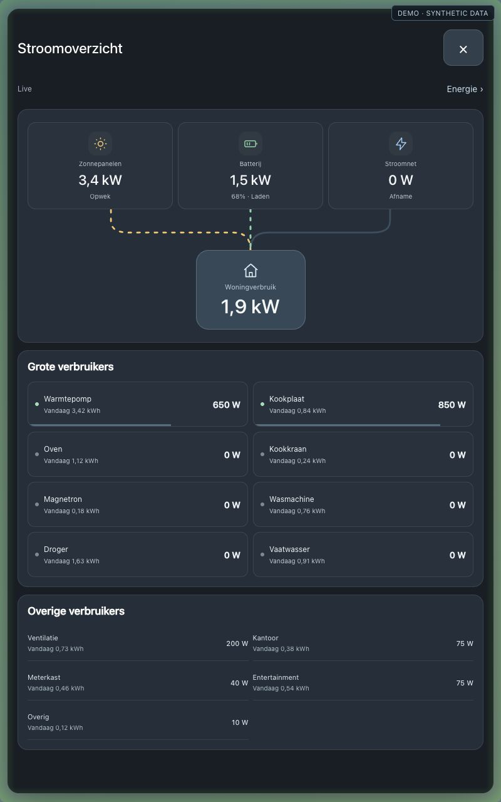

# Voorbeeldscreenshots

[English](README.md) · **Nederlands**

Deze beelden zijn vastgelegd in de echte Light Panel-interface met uitsluitend fictieve gegevens. Het DEMO-label staat in elk beeld. De waarden zijn geen metingen van een huishouden. De stilstaande beelden tonen een moment uit de geanimeerde meldingen; de twee alarmbeelden tonen de eindstand.

De drie meetgrafieken zijn bijgesneden om het detail leesbaar te tonen.

| Wasmachine klaar | Vaatwasser klaar |
| --- | --- |
|  |  |

| Alarm ingeschakeld | Alarm uitgeschakeld |
| --- | --- |
|  |  |

| Weer, zon en maan | Uur- en meerdaagse verwachting |
| --- | --- |
|  |  |

| Tapwatertemperatuur warmtepomp | Temperatuurverloop woning |
| --- | --- |
|  |  |

| Vermogensverloop warmtepomp | Apparaten: vermogen en dagtotalen |
| --- | --- |
|  |  |

## Opnieuw maken

Start `python tools/screenshot_demo.py` vanuit de projectmap met de projectafhankelijkheden geïnstalleerd. Open `http://127.0.0.1:8093/` en kies een voorbeeld. De voorbeeldbediening verdwijnt automatisch; Escape opent die weer. De preview leest geen `.env`, benadert geen HA en stuurt geen echte apparaten aan. De datum en alle sensoren zijn vaste, fictieve voorbeelden.

De [HTML-galerij](index.html) werkt ook lokaal met deze afbeeldingen.
